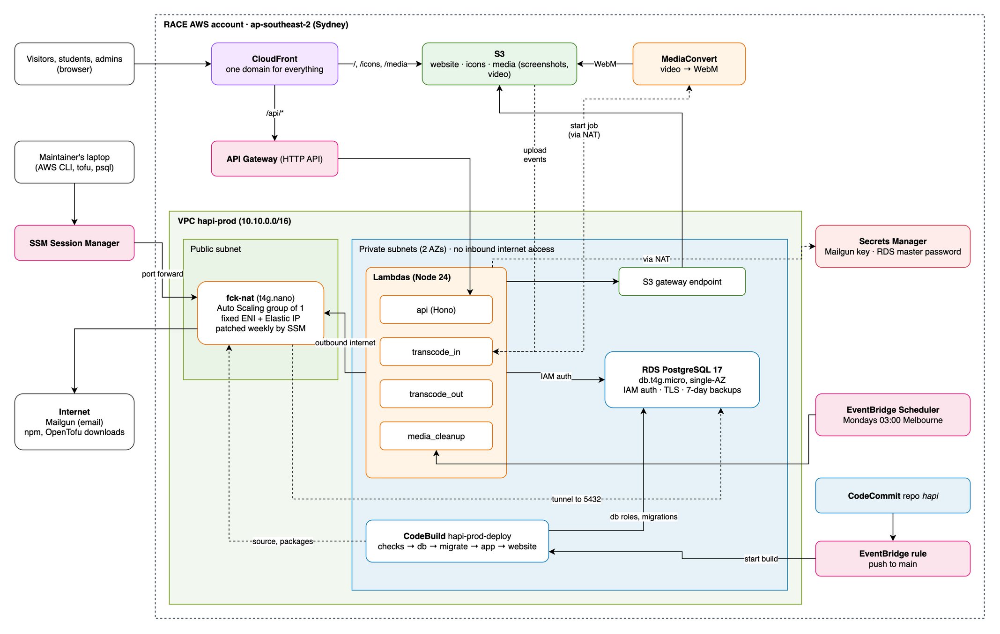

# Infrastructure design

The cloud infrastructure runs entirely on AWS, in `ap-southeast-2` (Sydney).
It was chosen to satisfy these requirements:

- High availability
- Low cost
- Simple administration and maintenance
- The security rules of RACE, the RMIT team that owns the AWS account:
  every IAM role is named `rmit-…` and carries RACE's permissions boundary,
  there are no IAM users, and secrets live only in AWS Secrets Manager

The diagram's source is [`infrastructure-diagram.drawio`](infrastructure-diagram.drawio).
Edit it with [draw.io](https://www.drawio.com/) and export it over
`images/infra-diagram.png` when the infrastructure changes.



```
Browser ──► CloudFront ──► S3 (frontend, /media, /icons)
                     └──► API Gateway (HTTP) ──► api Lambda (private subnets)
                                                    ├──► RDS PostgreSQL 17 (private, IAM auth, TLS)
                                                    ├──► S3 (gateway endpoint)
                                                    └──► fck-nat ──► Internet (Mailgun, Secrets Manager, MediaConvert)
S3 screenshots bucket ──► transcode_in / transcode_out Lambdas (private subnets)
EventBridge Scheduler ──► media_cleanup Lambda (private subnets)
CodeCommit main ──► EventBridge ──► CodeBuild (private subnets) ──► checks ► db ► migrate ► app ► frontend
Admins ──► SSM Session Manager ──► fck-nat instance ──(port forward)──► RDS
```

## Serving the frontend

The frontend HTML/JS/CSS is served from an [S3 bucket](https://aws.amazon.com/s3/),
so there is no web server to maintain. The site is built and uploaded by the
[deploy pipeline](../processes/CI-CD.md). Cost is well under $1 USD per month.

The bucket sits behind an [Amazon CloudFront](https://docs.aws.amazon.com/AmazonCloudFront/latest/DeveloperGuide/Introduction.html)
distribution, which reduces latency for visitors around the world and also
serves uploaded media (`/media`, `/icons`) and the API (`/api`).

## Serving the API

The API is a [Hono app](https://hono.dev/) on [AWS Lambda](https://docs.aws.amazon.com/lambda/latest/dg/welcome.html),
behind an [API Gateway](https://docs.aws.amazon.com/apigateway/latest/developerguide/welcome.html)
HTTP API, which is itself behind CloudFront.

Traffic is expected to be low, and with Lambda we pay only when the API is
used. AWS runs more instances automatically when demand rises, and there are
no servers to patch.

Media processing runs on three more Lambdas: `transcode_in` (starts an
[Elemental MediaConvert](https://aws.amazon.com/mediaconvert/) job for each
uploaded video), `transcode_out` (publishes the result) and `media_cleanup`
(weekly removal of media nothing references any more).

## Network

All Lambdas, the database and the build pipeline run in **private subnets**
of a dedicated VPC, with no inbound access from the internet.

- **S3** traffic goes through a free VPC gateway endpoint.
- **Internet egress** (email via Mailgun, Secrets Manager, the MediaConvert
  API, package downloads during builds) goes through a single
  [fck-nat](https://fck-nat.dev) instance, an open-source NAT image on a
  `t4g.nano`. It costs a few dollars a month instead of the ~$40+ of an AWS
  NAT Gateway. It runs in an Auto Scaling Group, so a failed instance is
  replaced automatically, and it keeps a fixed public IP. It is patched
  weekly by SSM. Patch reboots briefly interrupt outbound internet only; the
  database and S3 are unaffected.

## Database

[Amazon RDS for PostgreSQL](https://aws.amazon.com/rds/postgresql/) 17
(matching Supabase Local, which developers still use), single-AZ, encrypted,
with 7 days of automated backups and deletion protection.

- **No application passwords.** Lambdas connect as `hapi_app` and migrations
  run as `hapi_owner`, both with
  [IAM database authentication](https://docs.aws.amazon.com/AmazonRDS/latest/UserGuide/UsingWithRDS.IAMDBAuth.html):
  a 15-minute token signed with the function's own IAM role.
- `hapi_owner` owns the schema objects; `hapi_app` can only read and write
  rows. These roles and grants are code (`infra/db`), applied by the pipeline.
- Only the RDS master user has a password. RDS manages and rotates it in
  Secrets Manager, and only the pipeline reads it, to apply `infra/db`.
- TLS is enforced by the server (`rds.force_ssl`) and verified by every client.
- There is no RDS Proxy. Connections are capped by giving each Lambda
  reserved concurrency and a pool of one connection (budget documented in
  `infra/app/main.tf`).

Humans reach the database only through an SSM Session Manager port forward
([runbook](runbooks.md#database-access-ssm-port-forward)).

## Identity and secrets

- Every role (one per Lambda, MediaConvert, the scheduler, the NAT instance,
  CodeBuild and its trigger) is created through `infra/modules/iam_role`.
  That module enforces the `rmit-hapi-<env>-` name and the permissions
  boundary, and permissions are inline and scoped to specific resources.
- There are no IAM users or access keys in this project. The pipeline uses
  its CodeBuild role. Humans use the IAM user RACE provides.
- The one application secret, the Mailgun API key, is stored in Secrets
  Manager. The api Lambda receives only its ARN and reads the value at start-up.

## Infrastructure as Code

All cloud resources are managed with [OpenTofu](https://opentofu.org/) in
[`infra/`](../../infra), split by lifecycle:

| Root | Scope | Applied by |
|---|---|---|
| `bootstrap` | Per account: state bucket, CodeCommit repo | Admin, once |
| `platform` | Per environment: VPC, NAT, RDS, secret container, CodeBuild pipeline | Admin, when it changes |
| `db` | Per environment: Postgres roles and grants | Pipeline |
| `app` | Per environment: Lambdas, API Gateway, CloudFront, buckets | Pipeline |
| `local_dev` | Per account: media buckets for local development ([details](../dev/dev-environment.md#media-images-and-video)) | Admin, once |

The pipeline cannot modify `platform`, so it cannot change its own
permissions. [Deploying to the RACE AWS account](deploy-to-race.md) covers the first-time setup, and the [runbooks](runbooks.md) cover operations. [Decisions](decisions.md) explains why things are built this way, and [known issues](../known-issues.md) lists what's still wrong.
